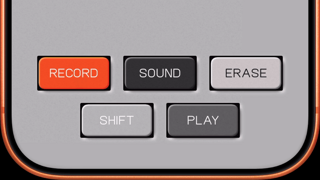

# Teenage Engineering Button

A recreation of the EP-133 K.O. II buttons, built entirely in pure SwiftUI. Inner shadows, grain texture and press animation.



## Example

```swift
EngineeringButton(text: "RECORD", palette: .orange) {
    print("tapped")
}
```

Palettes: `.orange`, `.darkGray`, `.gray`, `.lightGray`, `.white`.

## Requirements

iOS 16.6+, Xcode 15+

## Credits

Design by [Teenage Engineering](https://teenage.engineering/products/ep-133). Technotype font used for demo purposes only.
